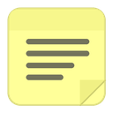

# StickyDesk

<p align="center">
  
</p>

<p align="center">
  A local-first sticky notes app for Linux, Windows, and macOS, built with Rust and
  <a href="https://crates.io/crates/gpui-kit">GPUI Kit</a>.
</p>

<p align="center">
  <a href="README.zh-CN.md">简体中文</a> ·
  <a href="https://github.com/luckzylp/sticky-desk/releases">Releases</a> ·
  <a href="https://github.com/luckzylp/sticky-desk/actions/workflows/ci.yml">CI</a>
</p>

<p align="center">
  <a href="https://github.com/luckzylp/sticky-desk/actions/workflows/ci.yml">
    
  </a>
  <a href="https://github.com/luckzylp/sticky-desk/releases">
    
  </a>
</p>

StickyDesk keeps notes as small floating cards. Notes are stored locally in SQLite and can be
organised into notebooks, searched, starred, edited as Markdown, exported, and printed. The current
card design follows Microsoft Sticky Notes 6.0.2.0: flat color surfaces, a 32px title bar that
stays out of the way until hover, a bottom formatting bar, and folded-corner cards in the note list.

Linux is the primary target and has the most complete desktop integration (tray icon, autostart,
desktop entry). CI also builds Windows and macOS binaries.

## Features

- **Floating note cards** — borderless, color-filled windows with 8px rounded corners and a
  title bar that appears on hover. Notes can be resized, collapsed, locked, duplicated, hidden, and
  arranged in notebooks.
- **Markdown editor** — bold, italic, underline, strikethrough, highlight and font colors,
  bullet/numbered/check lists, alignment, font size, live preview, and find & replace.
- **Explorer** — All Notes, Starred, Trash, notebooks, search, sorting, multi-select bulk actions,
  restore, permanent delete, and move to notebook.
- **Note menu** — color wheel, opacity, size presets, lock, export as Markdown, print, locate in
  Explorer, and hide/delete. The menu is capped to the note window height and scrolls when the card
  is short.
- **Personalisation** — note colors, opacity, per-note font and font size, light/dark/system themes,
  note color mode, and accent color.
- **Local-first storage** — SQLite with WAL and asynchronous writes. The database folder can be
  changed from Settings, including pointing at an existing `Notes.db`.
- **Desktop integration (Linux)** — StatusNotifierItem tray icon, close to tray, run at login,
  single instance, and keyboard shortcuts.
- **13 UI languages** — English, 简体中文, Dansk, Français, Deutsch, Italiano, 日本語, Nederlands,
  Português, Русский, Español, Svenska, and Türkçe.

## Requirements

### Linux

- X11 or Wayland
- Rust **1.85+** (the project uses edition 2024)
- System libraries (Debian/Ubuntu):

```bash
sudo apt-get install -y --no-install-recommends \
  pkg-config clang cmake make \
  libx11-dev libx11-xcb-dev libxcb1-dev libxcb-render0-dev \
  libxcb-shape0-dev libxcb-xfixes0-dev \
  libxkbcommon-dev libxkbcommon-x11-dev \
  libwayland-dev wayland-protocols \
  libfontconfig1-dev libfreetype6-dev \
  libgl1-mesa-dev libegl1-mesa-dev libvulkan-dev \
  libasound2-dev
```

On GNOME, install a StatusNotifierItem/AppIndicator extension to see the tray icon.

### Windows and macOS

- Rust **1.85+**
- A working native Rust toolchain for the target platform
- Windows builds use MSVC; macOS CI builds arm64

Tray integration and Linux autostart are Linux-only.

## Build from source

```bash
git clone https://github.com/luckzylp/sticky-desk.git
cd sticky-desk
cargo run --release
```

The release binary is `target/release/sticky-desk` (`sticky-desk.exe` on Windows).

The repository vendors a patched `gpui-component` crate through `[patch.crates-io]`, so keep the
`vendor/` directory in the checkout.

## Install a release build

Download the artifact for your platform from
[Releases](https://github.com/luckzylp/sticky-desk/releases).

### Linux

`sticky-desk-linux-x86_64-glibc2.17.tar.gz` is built for older distributions;
`sticky-desk-linux-x86_64-glibc-latest.tar.gz` and
`sticky-desk-linux-arm64-glibc-latest.tar.gz` are built on current runners.

```bash
tar -xzf sticky-desk-linux-x86_64-glibc2.17.tar.gz
cd sticky-desk-linux-x86_64
install -Dm755 sticky-desk ~/.local/bin/sticky-desk
install -Dm644 share/applications/sticky-desk.desktop ~/.local/share/applications/
cp -r share/icons/* ~/.local/share/icons/
```

The release page also includes a bare binary without the desktop entry and icons.

### Windows and macOS

Download `sticky-desk-windows-x86_64.exe`, `sticky-desk-windows-arm64.exe`, or the macOS arm64
binary, then run it directly.

## Keyboard shortcuts

| Action | Shortcut |
| --- | --- |
| New note | `Alt+N` |
| New note from clipboard | `Alt+V` |
| Show all notes | `Alt+S` |
| Hide all notes | `Alt+H` |
| Next note | `Alt+G` |
| Open Explorer | `Alt+X` |

On macOS, use `Option` in place of `Alt`. The Settings window lists the current shortcuts under
**Hot Keys**.

## Data locations

Linux paths:

| What | Where |
| --- | --- |
| Notes database | `~/Documents/StickyDesk/Notes.db` (falls back to `~/.local/share/StickyDesk/Notes.db`) |
| Settings | `~/.config/sticky-desk/settings.json` |
| Alarm sounds | `~/.config/sticky-desk/Sounds/` |

On Windows and macOS these follow the platform config and document directories.

Use **Settings → Database location** to point StickyDesk at another folder containing `Notes.db`.
Back up the file before switching.

## Project layout

```text
src/
  main.rs             application entry point and shortcuts
  app/
    note_view.rs      floating note card and Markdown editor
    explorer.rs       note list, notebooks, trash
    settings_view.rs  settings window
    color_wheel.rs    note color picker
    tray.rs           Linux StatusNotifierItem tray
    windows.rs        window creation
    ...
  model.rs            notes and settings model
  store.rs            SQLite persistence
  theme.rs            note color helpers
  i18n.rs             translation loader
assets/
  i18n/               13 UI translations
  linux/              desktop entry and icons
vendor/gpui-component patched GPUI component library
```

## What's new in 0.5.1

- CI and release workflows now run on Ubuntu 24.04.
- Version bump for the 0.5.1 release.

## 0.5.0 highlights

- Redesigned note windows and Explorer cards after Microsoft Sticky Notes 6.0.2.0.
- Note windows keep only a close button; minimize and maximize were removed from the note UI.
- The note menu is bounded to the note window height and scrolls when the card is short.
- New notes default to `#FFF3AB` with a 15px font.
- README documentation in English and Simplified Chinese.

## Status

The current release is **0.5.1**. StickyDesk is usable for daily notes; back up `Notes.db` before
large reorganisations or database-folder changes.

## License

No license file has been added yet. Until a license is declared, all rights are reserved.
