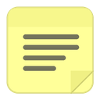

# StickyDesk

<p align="center">
  
</p>

<p align="center">
  面向 Linux、Windows 和 macOS 的本地优先便签应用，使用 Rust 和
  <a href="https://crates.io/crates/gpui-kit">GPUI Kit</a> 构建。
</p>

<p align="center">
  <a href="README.md">English</a> ·
  <a href="https://github.com/luckzylp/sticky-desk/releases">发布版本</a> ·
  <a href="https://github.com/luckzylp/sticky-desk/actions/workflows/ci.yml">CI</a>
</p>

<p align="center">
  <a href="https://github.com/luckzylp/sticky-desk/actions/workflows/ci.yml">
    
  </a>
  <a href="https://github.com/luckzylp/sticky-desk/releases">
    
  </a>
</p>

StickyDesk 把每张便签保存为一个悬浮小卡片。笔记保存在本地 SQLite 中，支持笔记本、搜索、星标、Markdown 编辑、导出和打印。当前卡片设计参考 Microsoft Sticky Notes 6.0.2.0：纯色平面、32px 标题栏（默认隐藏，鼠标移入才出现）、底部格式栏，以及列表中的折角卡片。

Linux 是主要目标平台，桌面集成最完整（托盘图标、开机启动、desktop entry）。CI 也会构建 Windows 和 macOS 二进制。

## 功能

- **悬浮便签卡片** —— 无边框、纯色背景、8px 圆角；标题栏默认隐藏，悬停时出现。便签支持缩放、折叠、锁定、复制、隐藏，并可按笔记本归类。
- **Markdown 编辑** —— 加粗、斜体、下划线、删除线、高亮和字体颜色、无序/有序/任务列表、对齐、字号、查找替换。
- **GitHub 风格预览** —— 标题、表格、任务列表、代码块、引用、链接、图片等 GFM 语法均可在卡片预览中渲染。
- **图片与拖拽** —— 把 PNG、JPEG、GIF、WebP、BMP 或 SVG 文件拖到便签上，文件会复制到数据库旁的 `attachments` 目录，并自动插入 Markdown 图片语法；同时支持 `data:` 图片 URL。
- **资源管理器** —— 全部笔记、星标、回收站、笔记本、搜索、排序、多选批量操作、恢复、永久删除、移动到笔记本。
- **便签菜单** —— 预览切换、颜色轮、透明度、尺寸预设、锁定、导出 Markdown、打印、在资源管理器中定位、隐藏/删除。菜单高度受便签窗口限制，卡片较矮时可滚动。
- **个性化** —— 便签颜色、透明度、每张便签的字体和字号、浅色/深色/跟随系统主题、便签颜色模式、强调色。
- **本地优先存储** —— SQLite + WAL，异步写入。可在设置中更换数据库目录，也可以选择已有的 `Notes.db`。
- **桌面集成（Linux）** —— StatusNotifierItem 托盘图标、关闭到托盘、开机启动、单实例、键盘快捷键。
- **13 种界面语言** —— English、简体中文、Dansk、Français、Deutsch、Italiano、日本語、Nederlands、Português、Русский、Español、Svenska、Türkçe。

## 环境要求

### Linux

- X11 或 Wayland
- Rust **1.85+**（项目使用 edition 2024）
- 系统依赖（Debian/Ubuntu）：

```bash
sudo apt-get install -y --no-install-recommends \
  pkg-config clang cmake make \
  libx11-dev libx11-xcb-dev libxcb1-dev libxcb-render0-dev \
  libxcb-shape0-dev libxcb-xfixes0-dev \
  libxkbcommon-dev libxkbcommon-x11-dev \
  libwayland-dev wayland-protocols \
  libfontconfig1-dev libfreetype6-dev \
  libgl1-mesa-dev libegl1-mesa-dev libvulkan-dev \
  libasound2-dev
```

GNOME 用户需要安装 StatusNotifierItem/AppIndicator 扩展才能看到托盘图标。

### Windows 和 macOS

- Rust **1.85+**
- 对应平台可用的原生 Rust 工具链
- Windows 使用 MSVC；macOS CI 构建的是 arm64

托盘集成和 Linux 开机启动仅适用于 Linux。

## 从源码构建

```bash
git clone https://github.com/luckzylp/sticky-desk.git
cd sticky-desk
cargo run --release
```

发布二进制位于 `target/release/sticky-desk`（Windows 下为 `sticky-desk.exe`）。

仓库通过 `[patch.crates-io]` 使用了一份打过补丁的 `gpui-component`，请保留 `vendor/` 目录。

## 安装发布版本

从 [Releases](https://github.com/luckzylp/sticky-desk/releases) 下载对应平台的产物。

### Linux

`sticky-desk-linux-x86_64-glibc2.17.tar.gz` 面向较老的发行版；
`sticky-desk-linux-x86_64-glibc-latest.tar.gz` 和
`sticky-desk-linux-arm64-glibc-latest.tar.gz` 使用较新的构建环境。

```bash
tar -xzf sticky-desk-linux-x86_64-glibc2.17.tar.gz
cd sticky-desk-linux-x86_64
install -Dm755 sticky-desk ~/.local/bin/sticky-desk
install -Dm644 share/applications/sticky-desk.desktop ~/.local/share/applications/
cp -r share/icons/* ~/.local/share/icons/
```

发布页也提供不带 desktop entry 和图标的单独二进制文件。

### Windows 和 macOS

下载 `sticky-desk-windows-x86_64.exe`、`sticky-desk-windows-arm64.exe` 或 macOS arm64 二进制后直接运行。

## 键盘快捷键

| 操作 | 快捷键 |
| --- | --- |
| 新建便签 | `Alt+N` |
| 从剪贴板新建便签 | `Alt+V` |
| 显示全部便签 | `Alt+S` |
| 隐藏全部便签 | `Alt+H` |
| 下一张便签 | `Alt+G` |
| 打开资源管理器 | `Alt+X` |

macOS 上使用 `Option` 代替 `Alt`。设置窗口的 **Hot Keys** 会列出当前快捷键。

## 数据位置

Linux 路径：

| 内容 | 位置 |
| --- | --- |
| 笔记数据库 | `~/Documents/StickyDesk/Notes.db`（没有文档目录时回退到 `~/.local/share/StickyDesk/Notes.db`） |
| 拖入的图片 | `~/Documents/StickyDesk/attachments/`（自定义 `Notes.db` 时为数据库旁的 `attachments` 目录） |
| 设置 | `~/.config/sticky-desk/settings.json` |
| 提醒声音 | `~/.config/sticky-desk/Sounds/` |

Windows 和 macOS 使用各自平台的配置目录和文档目录。

可以在 **设置 → Database location** 中把 StickyDesk 指向另一个包含 `Notes.db` 的目录。切换前请先备份数据库。

## 项目结构

```text
src/
  main.rs             应用入口和快捷键
  app/
    note_view.rs      悬浮便签卡片和 Markdown 编辑器
    explorer.rs       笔记列表、笔记本、回收站
    settings_view.rs  设置窗口
    color_wheel.rs    便签颜色选择器
    tray.rs           Linux StatusNotifierItem 托盘
    windows.rs        窗口创建
    ...
  model.rs            笔记和设置数据模型
  store.rs            SQLite 持久化
  theme.rs            便签颜色辅助函数
  i18n.rs             翻译加载
assets/
  i18n/               13 种界面翻译
  linux/              desktop entry 和图标
vendor/gpui-component 打过补丁的 GPUI 组件库
```

## 0.6.0 更新内容

- 移除便签标题栏的预览按钮，预览仍可从便签菜单中切换。
- GitHub 风格 Markdown 预览支持本地图片。
- 支持把图片文件拖到便签上，自动复制到 attachments 目录并插入 Markdown。
- 支持 `data:` 图片 URL。

## 0.5.1 更新内容

- CI 和发布工作流改用 Ubuntu 24.04 runner。
- 版本号升级到 0.5.1。

## 0.5.0 主要变化

- 参考 Microsoft Sticky Notes 6.0.2.0 重新设计便签窗口和资源管理器卡片。
- 便签窗口只保留关闭按钮，便签界面移除最小化和最大化。
- 便签菜单高度受便签窗口限制，卡片较矮时可滚动。
- 新建便签默认使用 `#FFF3AB` 和 15px 字号。
- 新增英文和简体中文 README。

## 状态

当前版本为 **0.6.0**。StickyDesk 可以日常使用；在进行大规模整理或更换数据库目录前，请先备份 `Notes.db`。

## 许可证

目前尚未添加许可证文件。在声明许可证之前，保留所有权利。
